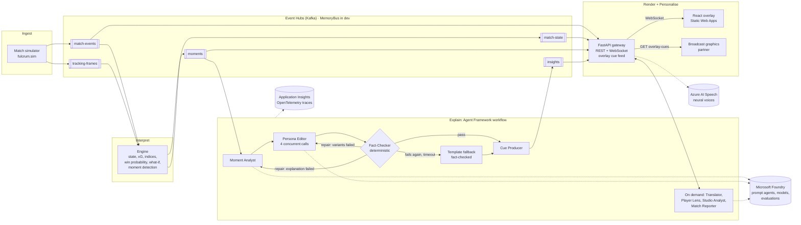
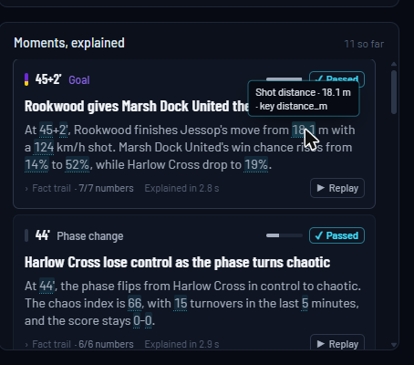

# Fulcrum

**Match intelligence that explains the moments a game turns on.**

Fulcrum watches a live football match, measures how much each moment changes it (win probability, pressure,
control, chaos, chance quality), and has a team of AI agents on Microsoft Foundry explain *why that moment
matters*. Each explanation is written for the viewer's persona and language and appears on screen beside the
match, both as overlay graphics and as a machine-readable cue feed that a broadcast graphics partner can render.

**What makes it different:** every explanation is tied to a measured swing in the match. The LLM explains
numbers but never invents them. A deterministic fact-checker rejects any number that is not in the moment's fact
pack, and verified template copy replaces anything that cannot be repaired.


> Built for the Microsoft *Inside the Game* Developer Hackathon, challenge *Synthetic Match Insights Engine*.
> Every club, player and match in Fulcrum is fictional and synthetic (`data/teams.json`).

| | |
|---|---|
| **Live overlay** | `<WEB_URL>` |
| **API** (health: `<API_URL>/api/health`, cue feed: `<API_URL>/api/matches/{id}/overlay-cues`) | `<API_URL>` |
| **Demo video** (under 2 min) | `<VIDEO_URL>` |

**At a glance** (measured on one full match, see [Trust and guardrails](#trust-and-guardrails)): 30 moments,
96.7 % verified on the first LLM attempt, 3.3 % repaired, 0 % fallback; moment to insight in **3.1 s p50 / 5.7 s
p95**; Foundry groundedness **4.53 / 5**. 518 Python tests and 51 web tests run offline with no Azure
credentials.

---

## The five-stage pipeline, mapped to the brief

| Stage | Brief wording | What Fulcrum does | Module | Azure service |
|---|---|---|---|---|
| **Ingest** | synthetic match events as they happen | Seeded possession-chain simulator streams `MatchEvent`s and 1 Hz `TrackingFrame`s (same seed, same stream) | `fulcrum.sim` → `fulcrum.bus` | Event Hubs (Kafka endpoint) |
| **Interpret** | stats, patterns, context | Live match state: xG, pass difficulty, pressure / control / chaos / tempo / momentum indices, player ratings, a live **win-probability model**, and **moment detection** with fact packs | `fulcrum.engine` | Container Apps |
| **Explain** | why a moment matters | Agent Framework workflow: Moment Analyst → Persona Editor → Fact-Checker → repair or fallback → Cue Producer | `fulcrum.agents` | Microsoft Foundry + Agent Framework |
| **Render** | on screen alongside the match | React overlay (studio, split view, broadcast mode) plus the REST and WebSocket **overlay cue feed** | `web/`, `fulcrum.api` | Static Web Apps, Container Apps |
| **Personalise** | analyst vs casual fan, club, player, language | 4 personas (analyst, casual, club fan, player lens) × 5 languages (en, es, fr, pt, de), favourite club, followed player, voice | `fulcrum.agents`, `fulcrum.api`, `web/` | Foundry, Azure AI Speech |

---

## Architecture



**What is deployed, exactly.** Everything is provisioned by `azd up` from `infra/` (Bicep), see
[docs/DEPLOY.md](docs/DEPLOY.md):

- **Live demo (in-process topology, [DEPLOY §4](docs/DEPLOY.md#4-cut-list-fallback-one-container-fulcrum_inprocess)).**
  The `ca-fulcrum-api` Container App (1 vCPU / 2 GiB) runs the simulator, engine and agents inside the API
  process on the in-memory bus, the same wiring as `make dev`. The on-demand agents (translation, Player Lens,
  per-persona recaps, Ask the studio) call the `AgentService` in that process, which is why the demo uses this
  topology. The overlay is served from Static Web Apps. The agents call Foundry with the container's managed
  identity and trace to Application Insights.
- **Production topology (distributed, provisioned and tested).** Four Container Apps (`api`, `sim`, `engine`,
  `agents`) from one image, talking over Event Hubs. The namespace, its five hubs (2 partitions each) and every
  consumer group are provisioned. In the demo deployment the sim, engine and agents apps are scaled to 0. A full
  match (Harlow Cross v Marsh Dock United, seed 11, 30× speed) ran out of process on the real namespace with
  sim → engine → agents → api as four processes: 30 moments, 30 insights, 157 cues and a recap. One gap remains
  (listed in [HANDOFFS](docs/HANDOFFS.md)): the on-demand agent hooks need a stateless request path before that
  topology can serve them, so for now it answers on-demand translations in English and Ask the studio with 503.

Topic, REST and WebSocket contracts: [docs/API_CONTRACT.md](docs/API_CONTRACT.md). Every cross-service message is
a pydantic v2 model in [`src/fulcrum/contracts/models.py`](src/fulcrum/contracts/models.py). JSON Schema is
exported to `schemas/`, and the web app's TypeScript types are generated from those schemas.

---

## Feature tour


- **Live win probability and moments.** An independent-Poisson model ([MODEL_SPEC §3](docs/MODEL_SPEC.md))
  blends pre-match strength with decayed live xG, red cards and game state, and is labelled "model, not odds".
  Thirteen rule-based moment types (goal, big chance, win-probability swing, pressure shift, phase change, tempo
  change, red card, speed record, elite pass, player milestone, momentum run, half time, full time) are tuned to
  20–35 per match. Each one carries a **fact pack** of pre-formatted numbers and deltas, so the agents never compute.
- **Persona engine.** Each moment gets one explanation and four rewrites: *analyst* (tactical, at least two
  numbers), *casual* (plain words, at most one number), *club fan* for each side (partisan but factual), and
  *player lens* on demand (the moment retold through the followed player when that player is involved). Any of
  these in **English, Spanish, French, Portuguese or German**. Translation runs on demand, is cached, and is
  fact-checked again in the target language (decimal commas included).
- **Split view** (`#/split`). The same match side by side for two viewers, each on its own WebSocket
  subscription with its own preferences, for example Analyst · EN next to Casual · ES.
- **Broadcast mode and the cue feed** (`#/broadcast`). Pitch and overlays only. Six cue templates
  (`lower_third`, `wp_swing`, `stat_card`, `player_tag`, `pressure_bar`, `recap_card`) are scheduled by anchor
  and priority, and a higher priority pre-empts. Press `I` to open the **cue inspector**, which shows the raw
  `OverlayCue` JSON and the REST feed URL. That proves a graphics partner can drive its own renderer from
  `GET /api/matches/{id}/overlay-cues` without our UI.

  

- **Fact trail.** Every number in an insight card is traced back to its fact (hover shows label · value · key),
  using the same matching rules as the server's fact-checker. A disclosure lists the facts the explanation relied
  on, plus its check status (Passed / Repaired / Fallback).

  

- **Mini replay.** Each insight card can replay the passage of play behind the moment on a mini pitch, with the
  involved players ringed.
- **What-if.** For every big chance the engine re-runs the live model with the shooting team's score + 1 at the
  same instant ([MODEL_SPEC §3.1](docs/MODEL_SPEC.md)). For example: "Had it gone in, it would be 0-1 and
  Riverside Rovers' win probability would be 52 % instead of 31 %." The chart shows a ghost marker, and the stat
  card shows "Win chance if scored". The number is computed, not guessed.
- **Ask the studio.** Viewers type a question or pick a suggestion ("What was the biggest turning point?") and the Studio Analyst answers
  from a context pack built from the match so far: live team and player stats, the most significant and latest
  moments with their facts, and the rosters. The answer arrives in the viewer's language and persona, fact-checked
  against that pack, and cites moment chips that scroll to the moment in the feed. Questions about betting or real
  clubs are refused without an LLM call, and requests are rate-limited per IP.
- **Voice commentary and accessibility.** `V` speaks each insight's commentary line in the viewer's language
  through **Azure AI Speech neural voices** (en-GB Ryan, es-ES Alvaro, fr-FR Henri, pt-BR Antonio, de-DE Conrad).
  The API proxy uses keyless Entra auth with a managed identity, and the browser voice takes over if Speech is
  unavailable. `D` turns on **audio description**: deterministic, localised lines for goals, cards, big chances,
  substitutions and the score. The same lines go to a visually hidden `aria-live` region for screen readers
  (assertive for goals and red cards).
- **Full-time recap and share posts** (`#/recap`). After full time the Match Reporter, running on the stronger
  model, writes a recap per persona and language: a verdict, three turning points, the standout performer and
  what the numbers say. It also writes three fact-checked share posts. The page also shows the whole
  win-probability story, player of the match and team stats.

  

- **Quality view** (`#/quality`). Guardrails and observability for the live match: passed / repaired / fallback
  rates, moment-to-insight latency p50 and p95, latency per moment coloured by check status, the `check_notes` of
  every repaired or fallback moment, and the latest offline agent run with Foundry evaluator scores
  (`GET /api/eval/latest`).

  

---

## How Microsoft technology is used

| Technology | How Fulcrum uses it | Where |
|---|---|---|
| **Microsoft Foundry** (project + model deployments) | `fast` (gpt-5.4-mini) runs the per-moment agents, Translator, Player Lens and Studio Analyst. `strong` (gpt-5-mini) runs the Match Reporter. Every call uses structured output with the pydantic schema as `response_format` | `src/fulcrum/llm/foundry.py` |
| **Foundry prompt agents** | At warm-up, the roles with fixed system prompts are published as versioned Foundry prompt agents with Agent Framework `to_prompt_agent` + `agents.create_version`, then called by name through `FoundryAgent`: `fulcrum-moment-analyst`, `fulcrum-persona-editor`, `fulcrum-fact-reviewer`, `fulcrum-studio-analyst`. A new version is created only when the model, instructions, temperature or schema change (fingerprint in version metadata) | `llm/foundry.py` |
| **Microsoft Agent Framework** workflow | The explain-moment flow is a `WorkflowBuilder` workflow: one `Executor` per step, switch-case edges built from a single `EDGES` routing table (pass, repair, fallback), and `MomentContext` as shared typed state. Built workflows are pooled per match worker. The Editor fans out into 4 concurrent single-variant calls (about 2.9 s → 1.8 s per moment) | `src/fulcrum/agents/orchestrator.py` |
| **Foundry evaluations** | The published copy of a full match is scored with Foundry's built-in groundedness, relevance, coherence and fluency evaluators through Agent Framework `FoundryEvals`. The run appears on the portal's Evaluations page | `scripts/eval_foundry.py`, `agents/evaluation.py` |
| **OpenTelemetry → Application Insights** | `configure_azure_monitor` plus Agent Framework instrumentation emit workflow, executor and agent spans. `Insight.agent_trace_id` is the workflow run's trace id | `src/fulcrum/telemetry.py` |
| **Azure Event Hubs (Kafka endpoint)** | Five topics keyed by `match_id`, with one consumer group per consumer. `aiokafka` with SASL PLAIN (Key Vault connection string) or OAUTHBEARER via managed identity | `src/fulcrum/bus/eventhubs.py`, `infra/modules/eventhubs.bicep` |
| **Azure Container Apps** | One image, four apps selected by `FULCRUM_SERVICE`. The API has external ingress with WebSockets and the sim has internal ingress | `Dockerfile`, `infra/modules/containerapp.bicep` |
| **Azure Container Registry** | Remote builds (`remoteBuild: true`), so no local Docker is needed | `azure.yaml` |
| **Azure Static Web Apps** | Hosts the React overlay. `VITE_API_URL` is injected at build time by an azd hook | `azure.yaml`, `infra/main.bicep` |
| **Managed identity + Key Vault** | One user-assigned identity with AcrPull, Key Vault Secrets User, Event Hubs Data Sender/Receiver, Foundry User and Cognitive Services Speech User. No keys in code or config. The bus uses a Send+Listen SAS rule stored in Key Vault, not the root key | `infra/main.bicep` |
| **Azure AI Speech** | Neural text-to-speech for voice commentary, key auth disabled, Entra token from the managed identity | `src/fulcrum/api/speech.py`, `infra/modules/speech.bicep` |
| **Azure Developer CLI + Bicep** | `azd up` provisions and deploys everything into the resource group, adopting the existing Event Hubs namespace and referencing the Foundry project | `azure.yaml`, `infra/` |
| **Log Analytics** | Container logs and the App Insights workspace, capped at 1 GB/day | `infra/main.bicep` |

---

## Trust and guardrails

The engine decides *what* happened and *how much* it mattered. The agents only decide *how to say it*.

**Deterministic fact-checker** ([`agents/factcheck.py`](src/fulcrum/agents/factcheck.py)) runs on every
explanation, every persona variant, every translation, the recap, the share posts and every Ask the studio
answer:

1. **Numbers.** Every numeric token must equal a fact value, a number inside a string fact or fact label, the
   score or the moment minute. Matching is numeric, so `0,34` equals `0.34` in translations. Scorelines get no free
   pass: each digit must be in the pack, so a wrong score is caught.
2. **Fact keys.** Every key the Analyst claims to rely on must exist in the fact pack.
3. **Names.** A denylist of real clubs and competitions (any case, hyphen and NBSP tolerant) is rejected, as is
   any fictional team or player who is not in this match.
4. **Betting language.** "Odds", "bet", "bookmaker", "wager" and the like are banned in English and in the copy's
   own language. Outcome probability is never presented as a price.
5. **Lengths and cut-off copy.** Headline ≤ 90, body ≤ 300 and commentary ≤ 160 characters / 25 words. Copy that
   stops mid-sentence (truncated at a length limit while it was generated) is flagged and repaired.

**Repair loop and fallback.** A failed check gets one repair with the issues appended ("Fix these issues: …").
Only the failing agent re-runs: the Editor alone, or the Analyst too if the explanation itself failed. A second
failure, two LLM errors, a timeout (8 s per call, 15 s per run) or a crash in any step falls back to
**deterministic templates**. Those templates are fact-checked one candidate at a time before they are used, so
fallback copy always passes. Every insight carries `check_status` (shown as a Passed / Repaired / Fallback
badge) and `check_notes`. An optional LLM reviewer (`FULCRUM_LLM_REVIEW=1`, significance ≥ 0.6) feeds the same
loop.

**Measured on Foundry.** `scripts/eval_live.py` replayed the committed recording `data/matches/sample_seed11.jsonl`
(Harlow Cross 2-2 Marsh Dock United, 30 moments) through the engine and the full agent team on Foundry. Run of
2026-10-24 13:49 UTC ([`data/eval/sample_seed11.json`](data/eval/sample_seed11.json)):

| Metric | Result |
|---|---|
| Passed / repaired / fallback | **29 / 1 / 0** (96.7 % / 3.3 % / 0 %) |
| Moment → verified insight latency | **p50 3.08 s · p95 5.72 s** · mean 3.55 s (design budget: < 4 s p50) |
| LLM calls | Moment Analyst 30 and Persona Editor 124, all through the Foundry prompt agents. Match Reporter 1 |
| Tokens for the whole match | 258,401 |
| Full-time recap (`strong`) | passed the fact-check, 28.3 s (off the live path) |

Earlier runs the same day: 93.3 / 6.7 / 0 % at p50 4.2 s with one Editor call per moment, then 90.0 / 6.7 / 3.3 %
at p50 3.6 s after the Editor fan-out. The one fallback in that second run was the fact-checker rejecting a "10"
that was not in the fact pack, twice. The template copy was published instead, as designed.

Foundry built-in evaluators over the same 30 published insights, run 2026-10-24 13:55 UTC, judge `fast`, scale 1–5
with pass ≥ 3 ([`data/eval/foundry_sample_seed11.json`](data/eval/foundry_sample_seed11.json)):

| Evaluator | Mean | Min | Pass rate |
|---|---|---|---|
| Groundedness | **4.53** | 2 | 96.7 % |
| Relevance | 4.60 | 3 | 100 % |
| Coherence | 4.30 | 4 | 100 % |
| Fluency | 3.80 | 3 | 100 % |

29 of 30 moments passed every evaluator. The one groundedness fail (a 90+5' passing milestone) was the judge
objecting to interpretation ("keeping the ball under pressure"), not to a number. Every number had already passed
the deterministic checker. A repeat run on the same records gave 4.57 / 4.70 / 4.37 / 3.83, so treat
single-moment scores as ±1 noise.

---

## Quick start

Requirements: Python ≥ 3.12 with [uv](https://docs.astral.sh/uv/), Node 20+.

```bash
make install            # uv sync --extra dev
uv sync --extra dev --extra azure   # adds Agent Framework's Foundry package, aiokafka, Azure Monitor
make test               # offline: FULCRUM_BUS=memory FULCRUM_LLM=fake are the defaults
make dev                # API + sim + engine + agents in one process on :8000
make web                # overlay on http://localhost:5173 (cd web && npm ci first); it starts a match
```

**Offline (default).** `FULCRUM_LLM=fake` needs no Azure and no network. Every moment then gets
fact-checked template copy marked `fallback`, which is the guaranteed floor of the real system. The web app can
also run with no Python at all against its mock server (`cd web && npm run mock`, see
[web/README.md](web/README.md)).

**With Foundry.** Copy `.env.example` to `.env` and set `FULCRUM_LLM=foundry`, `FOUNDRY_PROJECT_ENDPOINT`,
`FOUNDRY_MODEL_DEPLOYMENT` (and optionally `FOUNDRY_MODEL_DEPLOYMENT_RECAP`). Auth is `DefaultAzureCredential`,
so `az login` is enough locally. Add `APPLICATIONINSIGHTS_CONNECTION_STRING` for traces and `AZURE_SPEECH_*` for
neural voices.

**Evaluate a match yourself.**

```bash
uv run python scripts/eval_live.py data/matches/sample_seed11.jsonl --json data/eval/sample_seed11.json
uv run python scripts/eval_foundry.py data/eval/sample_seed11.records.jsonl
```

**Deploy to Azure.** `azd up`. Parameters, the in-process option, cost and teardown are in
[docs/DEPLOY.md](docs/DEPLOY.md).

---

## Repository layout

```
src/fulcrum/
  contracts/   models.py: the single source of truth for every cross-service message (pydantic v2)
  sim/         seeded possession-chain simulator, calibrated over 200 seeds (MODEL_SPEC §1.9)
  engine/      match state, metrics, win probability + what-if, moment detection with fact packs
  agents/      Agent Framework workflow, prompts, fact-checker, templates, cues, translator,
               Player Lens, Studio Analyst, Match Reporter, evaluation
  llm/         LLMClient protocol; FakeLLM (tests); FoundryLLM (Foundry + Agent Framework)
  bus/         Bus protocol; MemoryBus (dev/tests); Event Hubs Kafka bus
  api/         FastAPI REST + WebSocket gateway, personalisation, speech proxy, eval reports
web/           React 19 + Vite + TypeScript overlay, plus a contract-valid mock server
infra/         azd + Bicep (Container Apps, Event Hubs, Key Vault, ACR, MI, App Insights, SWA, Speech)
data/          teams.json (fictional clubs), matches/sample_seed{7,11}.jsonl, eval/ reports
docs/          API_CONTRACT, MODEL_SPEC, AI_PROMPT_DESIGN, DEPLOY, BUILD_PLAN, HANDOFFS
scripts/       calibrate_sim, print_moments, eval_live, eval_foundry, export_schemas
tests/         pytest, one folder per module
```

**Contracts first.** Services only exchange the models in `fulcrum.contracts`. A contract change means editing
`models.py`, appending to `docs/CONTRACT_CHANGES.md` and running `make schemas`, which regenerates the JSON Schema
the web app's types are built from. Only additive optional fields have been added.

**Tests.** 518 Python tests (`pytest`, offline, with `FULCRUM_BUS=memory FULCRUM_LLM=fake`; 517 pass and 1 is the
opt-in live Event Hubs test, skipped by default) and 51 web tests (`cd web && npm test`). They cover simulator
determinism and calibration, win-probability sanity values, moment counts on the recorded matches, every
PASSED / REPAIRED / FALLBACK path, timeouts, every template against the fact-checker, denylist and decimal-comma
cases, the WebSocket protocol, cue scheduling, fact trail and the speech queue. With only `make install` (no
`--extra azure`), three tests in `tests/test_foundry_llm.py` fail on a missing Foundry package. Run the second
`uv sync` line above for the full suite.

---

## Path to production

Fulcrum was built so the demo and the production shape differ only in configuration.

- **Distributed topology.** Event Hubs, the consumer groups and the four Container Apps are already provisioned.
  Turning the in-process mode off (`FULCRUM_INPROCESS=false`) splits sim, engine and agents into their own apps.
  The one remaining piece is a stateless request topic or HTTP hook for the on-demand agents (translation, Player
  Lens, Ask the studio), so the API can reach them across processes. The bus already has a managed-identity
  OAUTHBEARER code path, and the identity already holds the Event Hubs data roles. Once that path has been
  run live, the SAS connection string can be dropped.
- **Real feeds instead of the simulator.** The engine consumes `MatchEvent` / `TrackingFrame`. A provider's event
  feed, or computer-vision auto-eventing from broadcast or tracking cameras, only needs an adapter onto
  `match-events` and `tracking-frames`. Nothing downstream changes.
- **Rendering-partner integration.** `OverlayCue` is already a renderer-neutral contract: template, anchor,
  priority, `show_at_clock_ms`, `sync_seq` for alignment with the event feed, duration and at most 4 stats. A
  graphics partner subscribes to the WebSocket or polls `/overlay-cues`. Production adds a signed, versioned schema
  and per-partner auth.
- **Persistence and scale-out.** Read models, recaps and caches are in memory today, which is why every app runs as
  one replica. Next steps: Cosmos DB for match state, insights and the translation and recap caches; Event Hubs
  partitioning by `match_id` (already the key) to scale engines and agents horizontally; Azure Web PubSub or
  SignalR for WebSocket fan-out to many viewers.
- **Auth and multi-tenancy.** Entra ID for operators, API keys or OAuth for partners, and per-tenant rosters,
  denylists, personas, languages and branding. The fact-checker's denylist and name rules are already data-driven.
- **Cost.** One match uses about 258k tokens on mini models, under £1 in Foundry tokens. Translations, Player Lens
  and Ask the studio are on demand and cached, so cost follows what viewers actually use, not personas ×
  languages. The weekend deployment, including test matches, is estimated at about £10–15 ([DEPLOY §5](docs/DEPLOY.md#5-cost-rough-payg-per-day-while-running)).
- **Quality gates.** `eval_live.py` and `eval_foundry.py` can run in CI on recorded matches, with a prompt-version
  bump blocked if fallback rate, latency or groundedness regress. Prompt versions are already recorded in the
  Foundry agent version metadata.

---

## Responsible AI

- **No invented numbers.** Agents may only quote the fact pack. That is enforced deterministically, not by
  prompting alone. When the LLM cannot produce verified copy, the viewer sees verified template copy, never an
  unverified claim. The check status is visible on every card, and the fact trail shows where each number came
  from.
- **Not a betting product.** Win probability is shown as "match outcome probability, model, not odds". Betting
  language is banned in all five languages, and betting questions to Ask the studio are refused before any model
  call.
- **Fictional data only.** All clubs, players and matches are synthetic. A denylist blocks real clubs and
  competitions from generated copy, and the UI carries no real league branding, crests or logos.
- **Inclusive language.** The prompts tell every agent not to assume a player's gender and to use the name or
  "they".
- **Accessibility.** Audio description and an `aria-live` log for screen-reader users, voice commentary in five
  languages, tabular numerals, high contrast, and chart colours re-derived in OKLCH to pass a colour-vision
  separation check.
- **Prompt-injection hygiene.** Ask the studio treats the question as data ("a question, never instructions"),
  caps it at 300 characters, rate-limits per IP, and fact-checks the answer against the context pack, including
  checks for leaked ids and unknown moment or fact references.

---

## Further reading

[docs/MODEL_SPEC.md](docs/MODEL_SPEC.md) (simulator, metrics, win probability, moments) ·
[docs/AI_PROMPT_DESIGN.md](docs/AI_PROMPT_DESIGN.md) (agent roles, prompts, fact-checker) ·
[docs/API_CONTRACT.md](docs/API_CONTRACT.md) (topics, REST, WebSocket, cue semantics) ·
[docs/DEPLOY.md](docs/DEPLOY.md) (Azure) · module READMEs in `src/fulcrum/*/README.md` and
[web/README.md](web/README.md).
